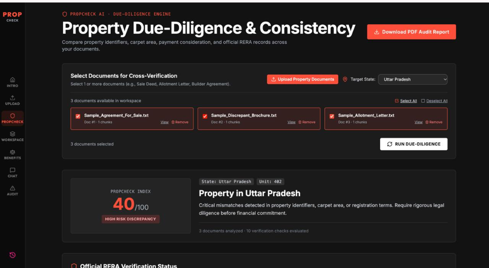
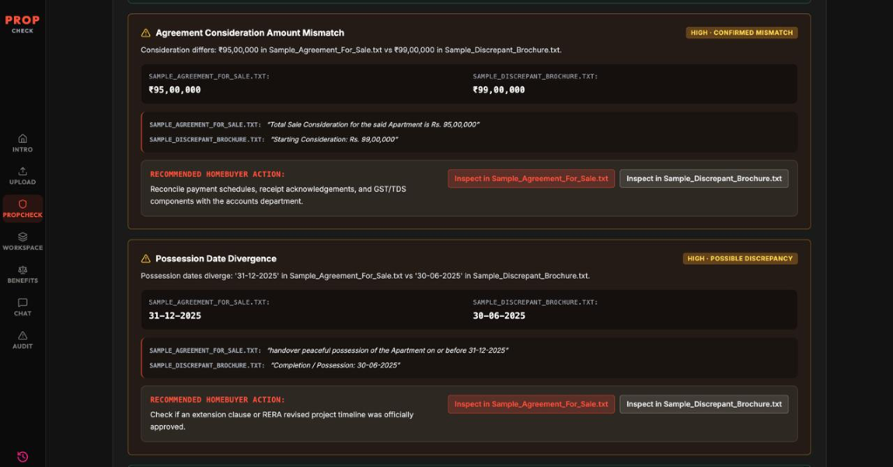
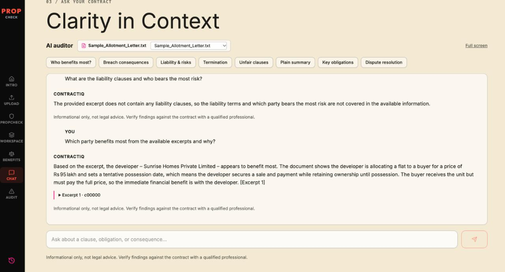

# PropCheck AI — Indian Property Due-Diligence Platform

**Live Prototype:** https://prop-check-ai.vercel.app/  
**Public Repository:** https://github.com/shaileshnitjsr/PropCheck-AI  
**Team:** Neural Ninjas

## Problem Statement

Property buyers in India often struggle to compare multiple property documents and identify inconsistencies in prices, possession dates, and property details. Complex legal language and manual verification make the process time-consuming and increase the risk of overlooking important issues.

## Our Solution

PropCheck AI is an AI-powered property due-diligence assistant that helps users analyze property documents, compare information across files, identify discrepancies, ask questions about contract content, and generate downloadable PDF audit reports.

## Key Features

- Upload and analyze property documents.
- Compare prices, possession dates, and property details across documents.
- Ask questions about contract content using AI.
- Review supporting evidence and potential issues.
- Check RERA registration-number formats and guide users toward official verification.
- Generate downloadable PDF audit reports.

## Screenshots & Demo

Explore PropCheck AI's key features through the screenshots below.

### 1. Property Due-Diligence Dashboard

The dashboard lets users select property documents, run cross-document verification, review the PropCheck Index, and access the downloadable PDF audit report.

### 2. Cross-Document Discrepancy Detection

PropCheck AI highlights inconsistencies between property documents, including differences in consideration amounts and possession dates. It displays supporting excerpts and suggested actions for further review.

### 3. Ask Your Contract — AI Assistant

Users can ask questions about contract clauses, obligations, liabilities, and risks. Responses are grounded in available document excerpts, with a reminder to verify findings professionally.

**Live Prototype:** https://prop-check-ai.vercel.app/

*Note: Screenshots use fictional sample property documents for demonstration. PropCheck AI provides informational assistance, not legal advice. RERA format checks do not confirm official registration.*

## Technology Stack

- **Frontend:** Next.js, React
- **Backend:** Python, FastAPI
- **AI:** Groq-hosted language model
- **Document Processing:** PDF parsing and OCR
- **Reports:** PDF generation using ReportLab

## Important Disclaimer

PropCheck AI is an informational tool and does not provide legal advice. RERA number-format checks do not confirm actual registration or establish the legitimacy of a property. Users should verify details through official sources and consult qualified professionals when needed.

The sample documents used for demonstrations are fictional and intended for testing only.
